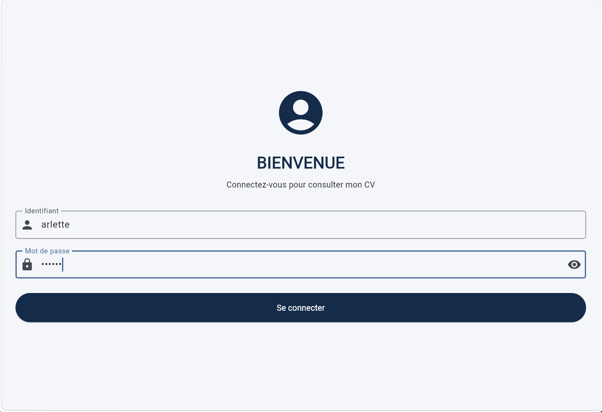
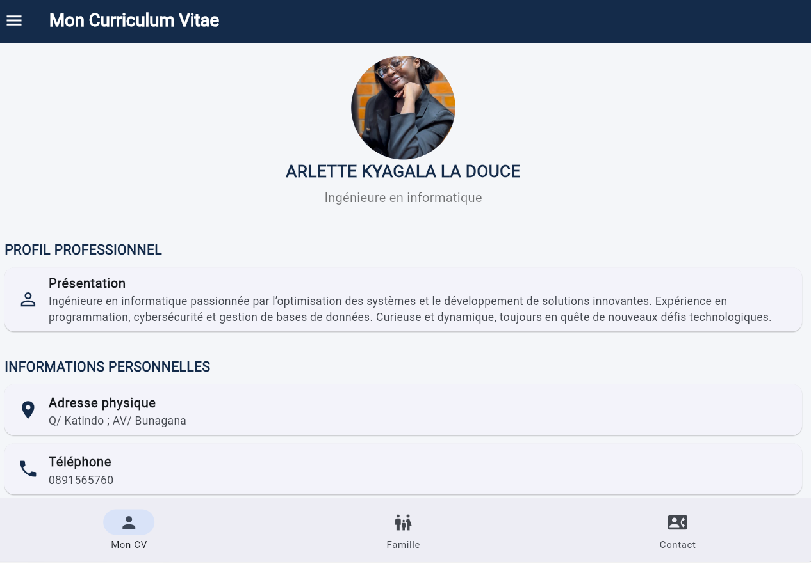
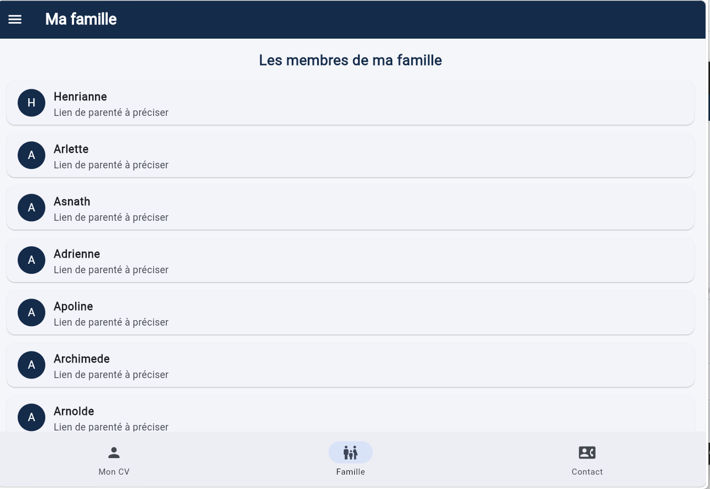
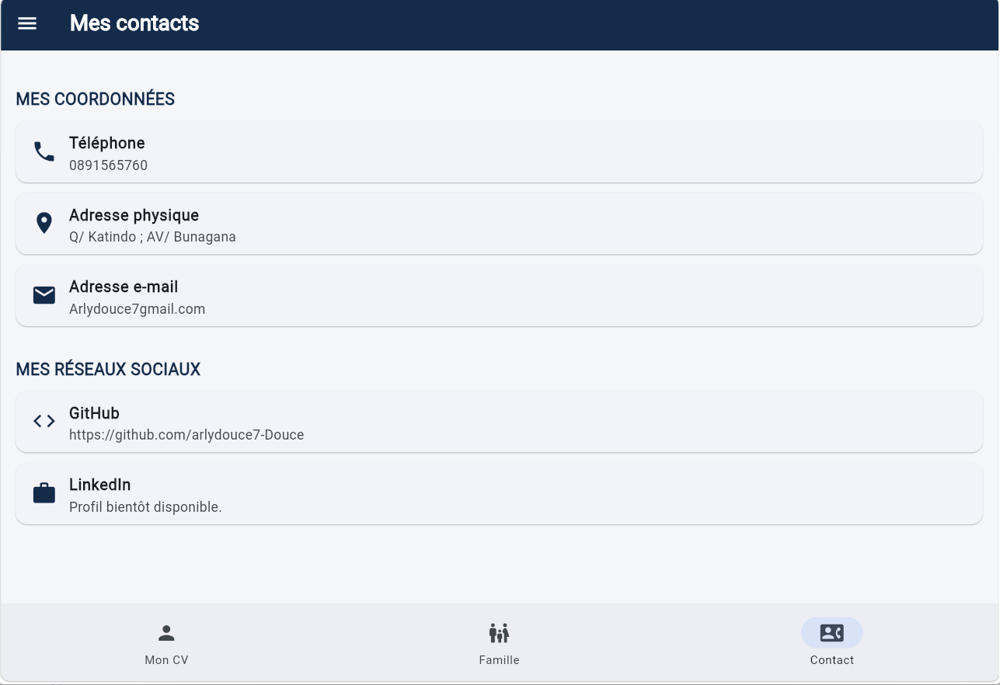

APPLICATION CV – ARLETTE KYAGALA LA DOUCE

Présentation du projet

Cette application mobile développée avec Flutter présente mon curriculum vitae à travers une interface simple, moderne et interactive.

Fonctionnalités

* Page de connexion avec identifiant et mot de passe.
* Page d’accueil présentant mon CV.
* Page famille présentant les membres de ma famille.
* Page contact avec mes coordonnées et mes réseaux sociaux.
* Navigation entre les différentes pages.

Technologies utilisées

* Flutter
* Dart
* Visual Studio Code
* Git et GitHub

Captures d’écran

### 1. Page de connexion

### 2. Page CV

### 3. Page famille

### 4. Page contact

Auteur

ARLETTE KYAGALA LA DOUCE

Projet académique réalisé dans le cadre des travaux pratiques Flutter à l’ISIG.